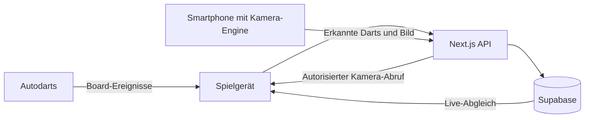

# Architektur

Die Next.js-Anwendung stellt Oberfläche und serverseitige API-Routen bereit. Supabase speichert Konten, Turniere, Lobbys und Spielstände. Browser rufen die autorisierten API-Routen auf; private Supabase-Schlüssel verbleiben auf dem Server.

## Verzeichnisse

- `src/app`: Seiten und API-Routen.
- `src/components`: Oberfläche, Match-Ansicht und Audio-Steuerung.
- `src/domain`: Spielregeln und Zustandsübergänge.
- `src/client`: Browser-Anbindungen und Audio-Wiedergabe.
- `src/server`: serverseitige Berechtigungen und Datenzugriff.
- `supabase/migrations`: aufeinander aufbauende Datenbankänderungen.
- `packages/camera-engine`: eigenständige Kamera-Engine mit eigener Lizenz, Modellen und Quellenangebot.
- `tests`: automatisierte Regeln-, API-, Datenbank- und Browserprüfungen.
- `tools/autodarts`: Diagnose; private Aufzeichnungen bleiben ausgeschlossen.

Spielaktionen werden serverseitig auf Sitzung, Berechtigung und erwartete Version geprüft. Automatische Erkennung verwendet denselben Regelpfad wie manuelle Eingabe; sie gewährt keine zusätzlichen Schreibrechte. Technische Rollenbezeichnungen bleiben für bestehende Daten kompatibel.

## Kamera

Die KI läuft im Browser des Kamerageräts. Für Inferenz ist kein eigener Python-/GPU-Server erforderlich. Die Kamera-Engine ist getrennt eingebunden; die Anwendung übernimmt Berechtigungen, Fernsteuerung und Transport. Der Build enthält Modelle und Referenzbilder mit Prüfsummen. Erzeugte Bundles und WASM-Dateien werden nicht eingecheckt.

Das Spielgerät empfängt bestätigte Erkennungsereignisse über die abgesicherte Kamera-Schnittstelle. Live-Bilder werden getrennt übertragen; Datenbank und Hosting bleiben trotzdem Teil des Betriebs. Einrichtung, Diagnose und Hardware-Grenzen stehen in [HANDYKAMERA.md](HANDYKAMERA.md).

## Zuschauer und Konten

Spieler benötigen bestätigte Konten. Zuschauerlinks öffnen eine getrennte Ansicht mit begrenztem Zugriff. Ein Zuschauerlink ist ein Zugang zur betreffenden Ansicht und sollte nur gezielt geteilt werden. Supabase-Datenbankregeln und serverseitige Prüfungen müssen auch bei eigener Installation erhalten bleiben.
